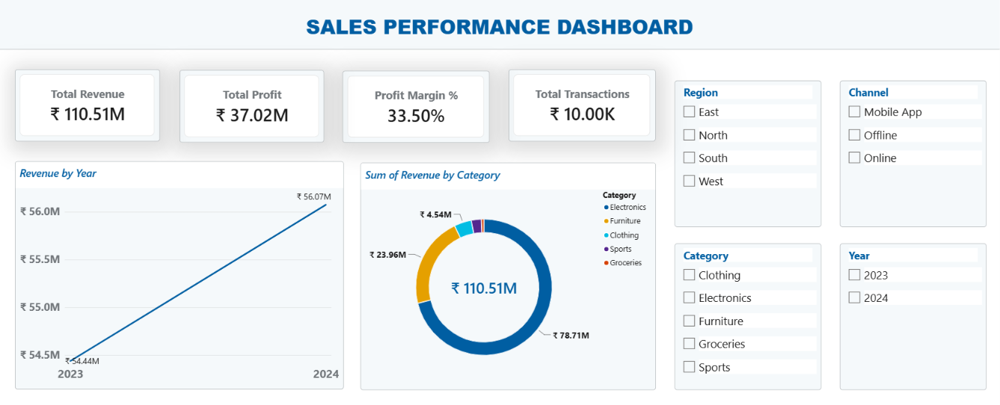
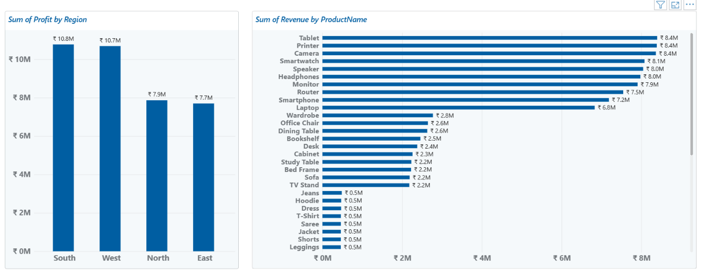

# Sales Analysis Using SQL Server

## Project Overview
Analyzed 10,000+ sales transactions using SQL Server
to understand product performance, monthly revenue
trends, regional sales, and profitability.

## Tools
- SQL Server Management Studio 22
- Microsoft SQL Server
- SQL

## Key Analysis
- Overall sales KPIs
- Top and low-performing products
- Monthly revenue trends and growth
- Regional performance
- Profit margins and returns
- Advanced SQL queries and views

## Business Insights
- Top product: Tablet
- Highest-revenue month: Nov, 2024
- Best-performing region: South
- Lowest-revenue region: East
- Overall profit margin: 33.50 %

## Dataset
- Source: [Retail Sales Dataset](https://github.com/Rameswar555/Retail-Sales-EDA/blob/main/Retail_Sales_Dataset.csv)
- Format: CSV
- Data Type: Retail sales transaction data
- Total Records: 10,000+

- ## Power BI Dashboard

The interactive dashboard presents key sales performance metrics and business insights.

### Dashboard Screenshots

## SQL Skills Demonstrated
- Data validation and quality checks
- Aggregations using GROUP BY
- Common Table Expressions (CTEs)
- Window functions and ranking
- Monthly revenue trend analysis
- Regional and product profitability analysis
- SQL views for reusable reporting

## Project Files
- `01_Data_Validation.sql` — Data quality checks
- `02_Sales_KPIs.sql` — Overall sales KPIs
- `03_Product_Analysis.sql` — Product performance
- `04_Monthly_Trends.sql` — Monthly trends
- `05_Regional_Analysis.sql` — Regional performance
- `06_Advanced_Analysis.sql` — Advanced SQL analysis
- `07_Sales_Summary_View.sql` — Sales summary view
- `08_Final_Data_Validation.sql` — Final validation checks
- `Sales_Analysis_Dashboard.pbix` — Power BI dashboard file
